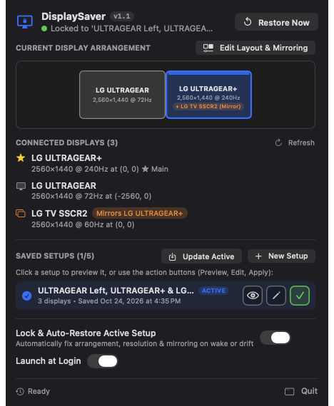
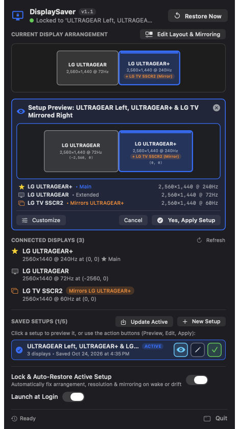
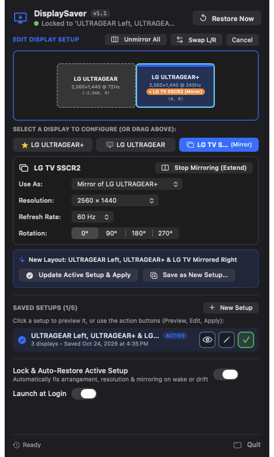

# DisplaySaver for macOS (`v1.1`)

**DisplaySaver** is a lightweight, native macOS menu bar utility that saves your multi-monitor arrangement, resolutions, refresh rates, scaling (HiDPI), orientations, and mirroring settings—and automatically locks and restores them whenever macOS tries to rearrange your screens on reboot, wake from sleep, or TV/HDMI hotplug events.

---

## 📸 Screenshots (`v1.1`)

| Main Dashboard & Quick Actions | Setup Preview & Confirmation | Edit Layout & Mirroring |
| :---: | :---: | :---: |
|  |  |  |

---

## 🚀 What's New in v1.1

- **Full Display & Mirroring Configuration (`Edit Layout & Mirroring`)**:
  - **Use As / Mirroring Control**: Switch any display between **Main Display ★**, **Extended Display (Separate)**, or **Mirror of [Display]**—plus one-click **Stop Mirroring (Extend)** and **Unmirror All** buttons right inside DisplaySaver.
  - **Per-Display Resolution, Refresh Rate & Rotation**: Choose any supported resolution (including HiDPI modes), refresh rate (`240Hz`, `144Hz`, `120Hz`, `72Hz`, `60Hz`), and rotation (`0°`, `90°`, `180°`, `270°`), or use quick position buttons (`Left of Main`, `Right of Main`, `Above Main`, `Below Main`, `Swap L/R`).
- **Save Up to 5 Custom Setups with Smart Auto-Naming**:
  - Save up to 5 custom display configurations (e.g., mirrored TV setup vs. unmirrored multi-monitor setup).
  - Automatically generates a concise, human-readable layout summary when saving or renaming (e.g., `ULTRAGEAR Left, ULTRAGEAR+ & LG TV Mirrored Right`).
- **One-Click Bordered Action Buttons (`Preview`, `Edit`, `Apply`)**:
  - Each saved setup features rounded-box icon buttons in order: **Preview (`👁`)**, **Edit (`✎`)**, and **Apply (`✓`)**—allowing you to either preview a setup's visual diagram before switching or apply a saved configuration immediately in a single click.
  - Includes Xcode-style floating hover tooltips that display full setup names and button actions without shifting the UI.
- **macOS 27.2 & Idle Sleep Stability Fixes**:
  - Moved runtime profile and log storage exclusively to `~/Library/Application Support/DisplaySaver` to prevent macOS `FileProvider` / TCC launch hangs.
  - Hardened background sleep/wake handling (`NSWorkspace.screensDidSleepNotification` and `CGDisplayIsAsleep`) and exception-safe log rotation so DisplaySaver never crashes or loops while your Mac is idle or asleep.

---

## ✨ Core Features

- **Automatic Display Layout Lock**: Listens to `CoreGraphics` display reconfiguration callbacks, system/screen wake events, and a background watchdog to automatically restore your saved layout if macOS shifts monitor origins, drops refresh rates (e.g., 60Hz → 30Hz on mirrored TVs), or breaks mirroring.
- **Two-Phase Mirror & Refresh Rate Restoration**: Safely restores hardware mirror sets (ensuring your primary monitor remains the Mirror Master at full refresh rate, such as 240Hz, while locking mirrored TVs/secondary displays to their target 60Hz native mode without triggering CoreGraphics `1010` transaction conflicts).
- **HDMI / TV Power-Transition Protection**: Prevents secondary or primary monitors from blanking out when a mirrored TV is turned off or on.
- **Smart Menu Bar & Dock Integration**:
  - Single-click the menu bar icon (`lock.display`) to open the quick popover.
  - Double-click (or right-click) the menu bar icon to open the standalone **DisplaySaver** window with a Dock icon.
  - Closing the window via the red close button (`✕`) hides the Dock icon while keeping DisplaySaver running silently in the background.
  - Full compatibility with **Bartender** and **macOS 27.2+** (runs from `/Applications/DisplaySaver.app`).
- **Launch at Login**: Built-in toggle to start automatically when you log in.

---

## 📦 Installation

### Option 1: Download Prebuilt Installer (`.dmg` or `.pkg`)
Download the latest release from the [**Releases**](../../releases) page:
- **`DisplaySaver-1.1.dmg`** *(Recommended)*: Open the disk image and drag **DisplaySaver.app** into your **Applications** folder.
- **`DisplaySaver-1.1-Installer.pkg`**: Double-click to run the standard macOS Installer wizard, which installs **DisplaySaver.app** directly into `/Applications`.

### Option 2: Build from Source
Requires macOS 14.0+ and Xcode Command Line Tools (`swiftc`).

```bash
git clone https://github.com/igotkilled/DisplaySaver.git
cd DisplaySaver
./build.sh
```

To build both the `.dmg` disk image and `.pkg` installer package locally:
```bash
./package.sh
```

---

## 🛠 How It Works

DisplaySaver uses native macOS frameworks (`CoreGraphics`, `CoreDisplay`, `IOKit`, and `MonitorPanel`) to query and persist each display's:
- Persistent `CFUUID` (`CGDisplayCreateUUIDFromDisplayID`) & fallback hardware vendor/model/serial ID (`ext-vendor-model-serial`)
- Global coordinate origin `(originX, originY)` and Main display status `(0, 0)`
- Logical resolution (`width × height`), physical pixel resolution (`pixelWidth × pixelHeight` for HiDPI), and `ioDisplayModeID`
- Refresh rate (`Hz`) and rotation (`0°`, `90°`, `180°`, `270°`)
- Mirror master UUID (`CGDisplayMirrorsDisplay` / `CGConfigureDisplayMirrorOfDisplay`)

Profiles are stored as human-readable JSON in `~/Library/Application Support/DisplaySaver/profiles.json`.

---

## 📄 License

Released under the [MIT License](LICENSE).
